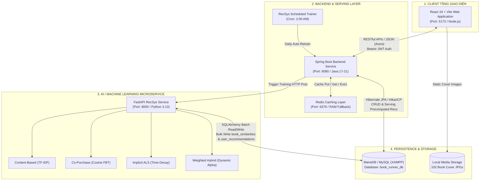
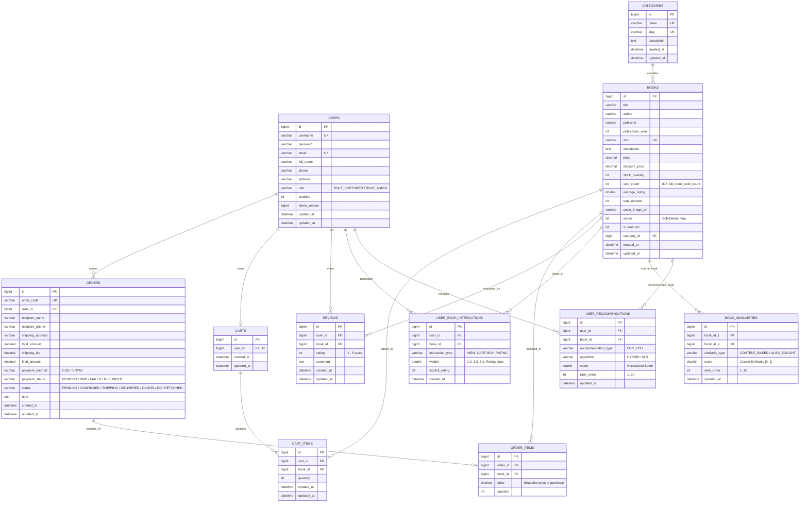
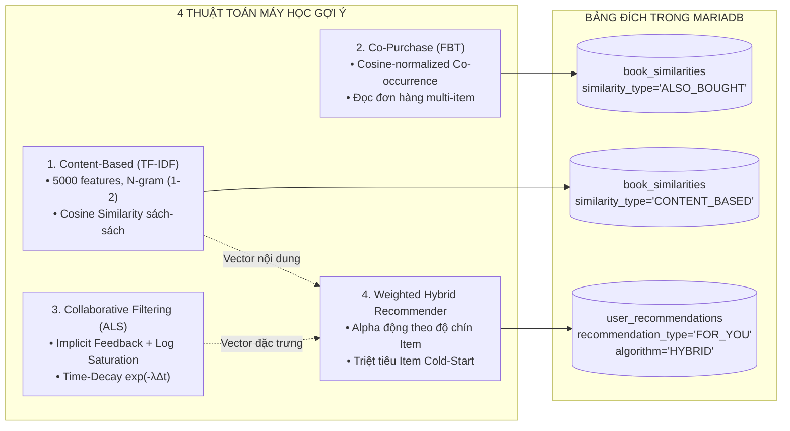
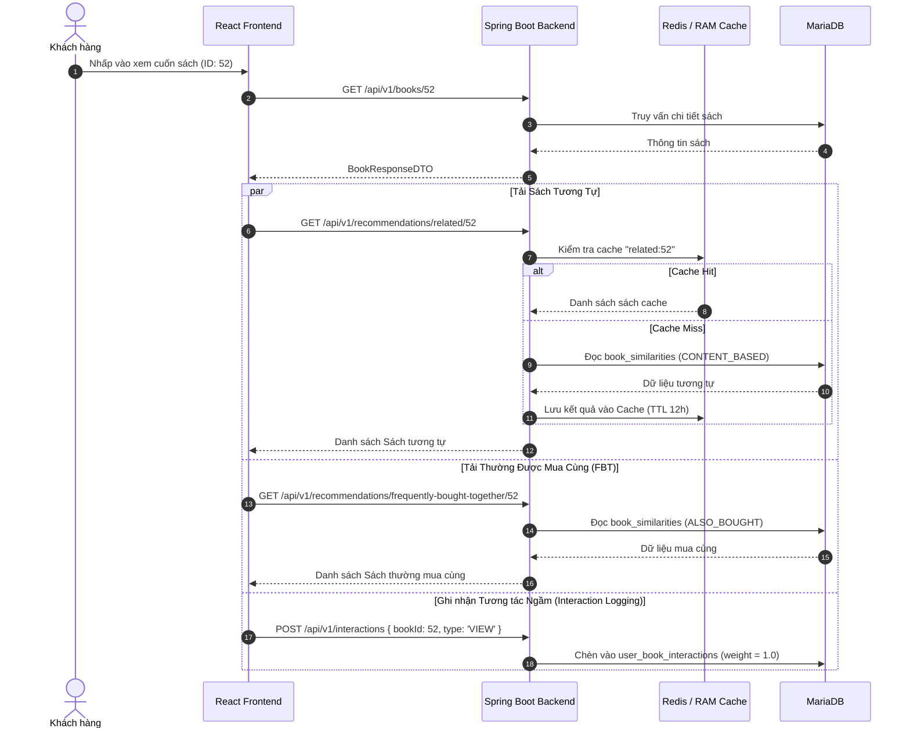
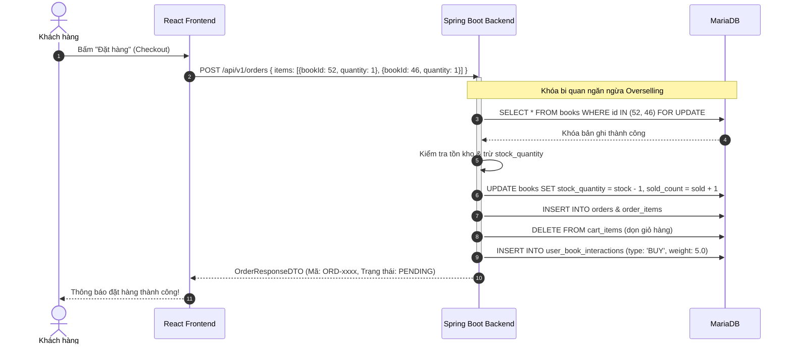
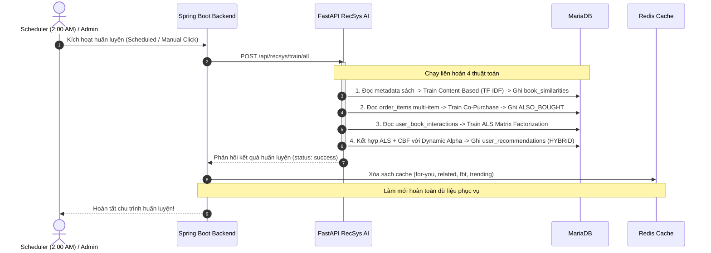

# BÁO CÁO TOÀN DIỆN KIẾN TRÚC, CƠ SỞ DỮ LIỆU & TÍNH NĂNG HỆ THỐNG
## DỰ ÁN: HỆ THỐNG BÁN SÁCH TRỰC TUYẾN TÍCH HỢP GỢI Ý THÔNG MINH (BOOKRUNNER)

> **Mã tài liệu:** BR-FULL-REPORT-2026  
> **Phiên bản:** 2.0 (Cập nhật sau khi hoàn tất Hybrid Recommender, FBT Co-Purchase & Advanced Filtering)  
> **Ngày lập báo cáo:** 27/10/2026  
> **Phạm vi khảo sát:** Toàn bộ 3 phân hệ (`book-runner`, `TT_Goi_y`, `Front_End`), Cơ sở dữ liệu MariaDB và Bộ đệm Redis.

---

## 📑 MỤC LỤC BÁO CÁO

1. [I. TỔNG QUAN DỰ ÁN & MỤC TIÊU HỆ THỐNG](#i-tổng-quan-dự-án--mục-tiêu-hệ-thống)
2. [II. KIẾN TRÚC TỔNG THỂ HỆ THỐNG (SYSTEM ARCHITECTURE)](#ii-kiến-trúc-tổng-thể-hệ-thống-system-architecture)
   - [2.1. Mô hình Microservices & Luồng dữ liệu](#21-mô-hình-microservices--luồng-dữ-liệu)
   - [2.2. Vai trò & Công nghệ từng phân hệ](#22-vai-trò--công-nghệ-từng-phân-hệ)
3. [III. THIẾT KẾ CƠ SỞ DỮ LIỆU TOÀN DIỆN (DATABASE SCHEMA & DATA DICTIONARY)](#iii-thiết-kế-cơ-sở-dữ-liệu-toàn-diện-database-schema--data-dictionary)
   - [3.1. Sơ đồ Thực thể Liên kết (Entity-Relationship Diagram - ERD)](#31-sơ-đồ-thực-thể-liên-kết-entity-relationship-diagram---erd)
   - [3.2. Từ điển Dữ liệu Chi tiết (Data Dictionary - 11 Bảng)](#32-từ-điển-dữ-liệu-chi-tiết-data-dictionary---11-bảng)
   - [3.3. Cơ chế Khóa & Toàn vẹn Dữ liệu Nâng cao](#33-cơ-chế-khóa--toàn-vẹn-dữ-liệu-nâng-cao)
4. [IV. DANH MỤC TÍNH NĂNG CHI TIẾT THEO PHÂN HỆ](#iv-danh-mục-tính-năng-chi-tiết-theo-phân-hệ)
   - [4.1. Phân hệ Xác thực & Phân quyền (Authentication & Authorization)](#41-phân-hệ-xác-thực--phân-quyền-authentication--authorization)
   - [4.2. Phân hệ Quản trị & Duyệt Danh mục - Sách (Catalog Subsystem)](#42-phân-hệ-quản-trị--duyệt-danh-mục---sách-catalog-subsystem)
   - [4.3. Phân hệ Giỏ hàng (Cart Subsystem)](#43-phân-hệ-giỏ-hàng-cart-subsystem)
   - [4.4. Phân hệ Đơn hàng, Thanh toán & Quản lý Kho (Order & Checkout Subsystem)](#44-phân-hệ-đơn-hàng-thanh-toán--quản-lý-kho-order--checkout-subsystem)
   - [4.5. Phân hệ Đánh giá & Nhận xét Sách (Review Subsystem)](#45-phân-hệ-đánh-giá--nhận-xét-sách-review-subsystem)
   - [4.6. Phân hệ Báo cáo & Thống kê Quản trị (Admin Analytics & Dashboard)](#46-phân-hệ-báo-cáo--thống-kê-quản-trị-admin-analytics--dashboard)
   - [4.7. Phân hệ Gợi ý Sách Thông minh (AI Recommendation System - 4 Thuật toán)](#47-phân-hệ-gợi-ý-sách-thông-minh-ai-recommendation-system---4-thuật-toán)
   - [4.8. Phân hệ Bộ đệm Đa tầng (Redis Cache Layer with RAM Fallback)](#48-phân-hệ-bộ-đệm-đa-tầng-redis-cache-layer-with-ram-fallback)
   - [4.9. Phân hệ Tác vụ Tự động Định kỳ (Scheduled Tasks / Cron)](#49-phân-hệ-tác-vụ-tự-động-định-kỳ-scheduled-tasks--cron)
5. [V. MA TRẬN LIÊN KẾT & LUỒNG DỮ LIỆU ĐỒNG BỘ GIỮA CÁC CHỨC NĂNG](#v-ma-trận-liên-kết--luồng-dữ-liệu-đồng-bộ-giữa-các-chức-năng)
6. [VI. TỔNG HỢP DANH MỤC RESTFUL API TOÀN HỆ THỐNG](#vi-tổng-hợp-danh-mục-restful-api-toàn-hệ-thống)
7. [VII. DỮ LIỆU THỰC TẾ & CHỈ SỐ KIỂM ĐỊNH CHẤT LƯỢNG MÔ HÌNH](#vii-dữ-liệu-thực-tế--chỉ-số-kiểm-định-chất-lượng-mô-hình)
8. [VIII. HƯỚNG DẪN VẬN HÀNH & KHỞI CHẠY HỆ THỐNG](#viii-hướng-dẫn-vận-hành--khởi-chạy-hệ-thống)

---

## I. TỔNG QUAN DỰ ÁN & MỤC TIÊU HỆ THỐNG

**BookRunner** là nền tảng thương mại điện tử chuyên biệt dành cho ngành sách, được thiết kế theo hướng kiến trúc dịch vụ phân tách (Decoupled Services) kết hợp công nghệ Trí tuệ Nhân tạo / Học máy (Machine Learning) để giải quyết các bài toán cốt lõi:
1. **Trải nghiệm mua sắm mượt mà**: Cung cấp giao diện hiện đại (Single Page Application - React 19 + Vite), phân loại trực quan, tìm kiếm tức thì và thanh toán đa kênh (COD, VNPay).
2. **Cá nhân hóa trải nghiệm (Personalization)**: Tận dụng các thuật toán gợi ý tiên tiến (Implicit ALS, TF-IDF Content-Based, Item-Item Co-Purchase và Weighted Hybrid Recommender) để đề xuất đúng cuốn sách người dùng quan tâm.
3. **Giải quyết bài toán Cold-Start**: Cơ chế phục vụ gợi ý tự động chuyển đổi thông minh:
   - *User Cold-Start* (người dùng mới dưới ngưỡng tương tác): Fallback sang danh sách **Sách thịnh hành / Bán chạy**.
   - *Item Cold-Start* (sách mới nhập kho chưa có lượt mua): Thuật toán Lai ghép (Hybrid) tự động kích hoạt **Dynamic Item Confidence Weighting**, sử dụng 100% đặc trưng nội dung để đề xuất tới độc giả có gu đọc tương đồng.
4. **Hiệu năng & Khả năng chịu tải cao**: Tầng phục vụ gợi ý (Serving Layer) tại Backend độc lập hoàn toàn với quá trình huấn luyện máy học, kết hợp Redis Caching với cơ chế Zero-Crash RAM Fallback.

---

## II. KIẾN TRÚC TỔNG THỂ HỆ THỐNG (SYSTEM ARCHITECTURE)

### 2.1. Mô hình Microservices & Luồng dữ liệu

Hệ thống được tổ chức thành 3 phân hệ độc lập chia sẻ chung một cơ sở dữ liệu quan hệ (Shared Database Pattern):



---

### 2.2. Vai trò & Công nghệ từng phân hệ

| Phân hệ | Thư mục mã nguồn | Cổng (Port) | Ngôn ngữ & Framework | Thư viện & Công nghệ chủ đạo | Trách nhiệm chính trong hệ thống |
| :--- | :--- | :---: | :--- | :--- | :--- |
| **Frontend Web** | [`Front_End`](file:///C:/Users/testu/OneDrive/Máy tính/New folder (2)/Front_End) | `5173` | JavaScript (ES6+)<br>React 19 | Vite 8, Axios, React Router v7, Lucide Icons, Recharts | • Giao diện khách hàng (Customer UI) & Quản trị (Admin UI).<br>• Tìm kiếm tức thì Debounce 400ms, bộ lọc giá, danh mục dạng Pills.<br>• Quản lý trạng thái xác thực qua `AuthContext`, giỏ hàng và thanh toán. |
| **Backend API Core** | [`book-runner`](file:///C:/Users/testu/OneDrive/Máy tính/New folder (2)/book-runner) | `8080` | Java 17/21<br>Spring Boot 4.x | Spring Security (JWT), Spring Data JPA, Hibernate, Redis, ModelMapper | • Cung cấp 100% RESTful API nghiệp vụ thương mại điện tử.<br>• Quản lý phiên làm việc JWT rotation, bảo mật đa tầng `@PreAuthorize`.<br>• Khóa bi quan (`PESSIMISTIC_WRITE`) chống bán âm kho (Overselling).<br>• Phục vụ gợi ý thời gian thực với độ trễ < 20ms từ Redis/RAM.<br>• Tác vụ lịch trình `@Scheduled` tự động gọi tái huấn luyện AI lúc 2:00 sáng. |
| **RecSys Microservice** | [`TT_Goi_y`](file:///C:/Users/testu/OneDrive/Máy tính/New folder (2)/TT_Goi_y) | `8000` | Python 3.13<br>FastAPI | SQLAlchemy, Scikit-learn, Implicit ALS, SciPy, NumPy, PyMySQL | • Huấn luyện tính toán nặng ngoại tuyến (Offline Batch Training).<br>• Cài đặt 4 thuật toán: Content-Based, Co-Purchase FBT, Implicit ALS, Hybrid.<br>• Đo lường chỉ số đánh giá mô hình: Precision@K, Recall@K, NDCG@K.<br>• Ghi đè kết quả gợi ý vào Database để Spring Boot phục vụ. |
| **Cơ sở Dữ liệu Quan hệ** | `XAMPP MySQL` | `3306` | SQL / MariaDB | InnoDB Engine, UTF8MB4 | • Lưu trữ toàn bộ 11 thực thể nghiệp vụ và kết quả gợi ý.<br>• Đảm bảo tính toàn vẹn tham chiếu ACID qua Foreign Keys và Transactions. |
| **Bộ đệm Bộ nhớ** | In-Memory / Docker | `6379` | Redis / RAM Cache | `spring-boot-starter-data-redis`<br>`ConcurrentMapCacheManager` | • Lưu trữ tạm thời kết quả các API gợi ý đắt đỏ (`/for-you`, `/trending`, `/related`, `/frequently-bought-together`).<br>• Tự động kích hoạt cơ chế Fallback RAM an toàn khi chưa bật Redis Server. |

---

## III. THIẾT KẾ CƠ SỞ DỮ LIỆU TOÀN DIỆN (DATABASE SCHEMA & DATA DICTIONARY)

### 3.1. Sơ đồ Thực thể Liên kết (Entity-Relationship Diagram - ERD)



---

### 3.2. Từ điển Dữ liệu Chi tiết (Data Dictionary - 11 Bảng)

#### Bảng 1: `users` (Tài khoản người dùng & Phân quyền)
| Tên Cột | Kiểu Dữ Liệu | Ràng Buộc | Ý Nghĩa Nghiệp Vụ |
| :--- | :--- | :--- | :--- |
| `id` | `BIGINT` | `PK, AUTO_INCREMENT` | Định danh người dùng duy nhất |
| `username` | `VARCHAR(50)` | `NOT NULL, UNIQUE` | Tên đăng nhập (tối thiểu 3 ký tự) |
| `password` | `VARCHAR(255)` | `NOT NULL` | Mật khẩu băm an toàn theo thuật toán BCrypt |
| `email` | `VARCHAR(100)` | `NOT NULL, UNIQUE` | Địa chỉ email người dùng |
| `full_name` | `VARCHAR(100)` | `NULL` | Họ và tên đầy đủ |
| `phone` | `VARCHAR(20)` | `NULL` | Số điện thoại liên lạc |
| `address` | `VARCHAR(255)` | `NULL` | Địa chỉ giao hàng mặc định |
| `role` | `VARCHAR(20)` | `NOT NULL` | Enum: `ROLE_CUSTOMER`, `ROLE_ADMIN` |
| `enabled` | `BIT(1)` | `NOT NULL, DEFAULT 1` | Trạng thái kích hoạt tài khoản |
| `token_version` | `BIGINT` | `NOT NULL, DEFAULT 0` | Số phiên bản token để thu hồi JWT tức thì khi đổi mật khẩu/đăng xuất |
| `created_at`, `updated_at`| `DATETIME` | `NOT NULL` | Dấu thời gian tạo và cập nhật |

#### Bảng 2: `categories` (Thể loại sách)
| Tên Cột | Kiểu Dữ Liệu | Ràng Buộc | Ý Nghĩa Nghiệp Vụ |
| :--- | :--- | :--- | :--- |
| `id` | `BIGINT` | `PK, AUTO_INCREMENT` | Khóa chính danh mục |
| `name` | `VARCHAR(100)` | `NOT NULL, UNIQUE` | Tên thể loại (VD: Lập trình & CNTT, Kinh tế...) |
| `slug` | `VARCHAR(120)` | `NOT NULL, UNIQUE` | Đường dẫn thân thiện URL (VD: `lap-trinh-cntt`) |
| `description` | `TEXT` | `NULL` | Mô tả tóm tắt thể loại |

#### Bảng 3: `books` (Thông tin đầu sách)
| Tên Cột | Kiểu Dữ Liệu | Ràng Buộc | Ý Nghĩa Nghiệp Vụ |
| :--- | :--- | :--- | :--- |
| `id` | `BIGINT` | `PK, AUTO_INCREMENT` | Mã sách duy nhất |
| `title` | `VARCHAR(255)` | `NOT NULL` | Tựa đề sách tiếng Việt |
| `author` | `VARCHAR(150)` | `NOT NULL` | Tác giả hoặc nhóm tác giả |
| `publisher` | `VARCHAR(150)` | `NULL` | Nhà xuất bản |
| `publication_year` | `INT` | `NULL` | Năm phát hành |
| `isbn` | `VARCHAR(20)` | `NOT NULL, UNIQUE` | Mã định danh tiêu chuẩn quốc tế ISBN |
| `description` | `LONGTEXT` | `NULL` | Nội dung mô tả / giới thiệu sách (đầu vào TF-IDF) |
| `price` | `DECIMAL(12,2)` | `NOT NULL` | Giá niêm yết (VNĐ) |
| `discount_price` | `DECIMAL(12,2)` | `NULL` | Giá bán khuyến mãi (nếu có) |
| `stock_quantity` | `INT` | `NOT NULL, DEFAULT 0` | Số lượng sách thực tế trong kho |
| `sold_count` | `INT` | `NOT NULL, DEFAULT 0` | Số lượng đã bán (có Index `idx_book_sold_count` phục vụ sort bán chạy) |
| `average_rating` | `DOUBLE` | `NOT NULL, DEFAULT 0` | Điểm đánh giá trung bình (1.0 - 5.0) |
| `total_reviews` | `INT` | `NOT NULL, DEFAULT 0` | Tổng số lượt nhận xét |
| `cover_image_url` | `VARCHAR(255)` | `NULL` | Đường dẫn ảnh bìa cục bộ (`/images/books/{id}.jpg`) |
| `active` | `BIT(1)` | `NOT NULL, DEFAULT 1` | Cờ xóa mềm: `1` là đang kinh doanh, `0` là ngừng kinh doanh |
| `is_featured` | `BIT(1)` | `NOT NULL, DEFAULT 0` | Cờ sách nổi bật hiển thị trang chủ |
| `category_id` | `BIGINT` | `FK -> categories(id)` | Khóa ngoại thể loại sách |

#### Bảng 4: `orders` (Hóa đơn đặt hàng)
| Tên Cột | Kiểu Dữ Liệu | Ràng Buộc | Ý Nghĩa Nghiệp Vụ |
| :--- | :--- | :--- | :--- |
| `id` | `BIGINT` | `PK, AUTO_INCREMENT` | Khóa chính đơn hàng |
| `order_code` | `VARCHAR(50)` | `NOT NULL, UNIQUE` | Mã đơn hàng dạng `ORD-xxxx` |
| `user_id` | `BIGINT` | `FK -> users(id)` | Người đặt mua |
| `recipient_name` | `VARCHAR(100)` | `NOT NULL` | Tên người nhận hàng |
| `recipient_phone`| `VARCHAR(20)` | `NOT NULL` | Điện thoại người nhận |
| `shipping_address`| `VARCHAR(255)`| `NOT NULL` | Địa chỉ nhận hàng |
| `total_amount` | `DECIMAL(12,2)` | `NOT NULL` | Tổng tiền hàng |
| `shipping_fee` | `DECIMAL(12,2)` | `NOT NULL, DEFAULT 20000` | Phí vận chuyển |
| `final_amount` | `DECIMAL(12,2)` | `NOT NULL` | Tổng thanh toán (`total_amount + shipping_fee`) |
| `payment_method` | `VARCHAR(20)` | `NOT NULL` | `COD`, `VNPAY` |
| `payment_status` | `VARCHAR(20)` | `NOT NULL` | `PENDING`, `PAID`, `FAILED`, `REFUNDED` |
| `status` | `VARCHAR(20)` | `NOT NULL` | State Machine: `PENDING`, `CONFIRMED`, `SHIPPING`, `DELIVERED`, `CANCELLED`, `RETURNED` |

#### Bảng 5: `order_items` (Chi tiết sản phẩm đơn hàng)
| Tên Cột | Kiểu Dữ Liệu | Ràng Buộc | Ý Nghĩa Nghiệp Vụ |
| :--- | :--- | :--- | :--- |
| `id` | `BIGINT` | `PK, AUTO_INCREMENT` | Khóa chính |
| `order_id` | `BIGINT` | `FK -> orders(id)` | Thuộc đơn hàng nào |
| `book_id` | `BIGINT` | `FK -> books(id)` | Cuốn sách được mua |
| `price` | `DECIMAL(12,2)` | `NOT NULL` | Giá bán chốt tại thời điểm mua (Snapshot Price) |
| `quantity` | `INT` | `NOT NULL` | Số lượng mua |

#### Bảng 6: `user_book_interactions` (Log tương tác phục vụ Máy học)
| Tên Cột | Kiểu Dữ Liệu | Ràng Buộc | Ý Nghĩa Nghiệp Vụ |
| :--- | :--- | :--- | :--- |
| `id` | `BIGINT` | `PK, AUTO_INCREMENT` | Khóa chính tương tác |
| `user_id` | `BIGINT` | `FK -> users(id)` | Người dùng tương tác |
| `book_id` | `BIGINT` | `FK -> books(id)` | Cuốn sách được tương tác |
| `interaction_type` | `VARCHAR(30)` | `NOT NULL` | `VIEW` (xem), `CART` (thêm giỏ), `BUY` (mua), `RATING` (đánh giá) |
| `weight` | `DOUBLE` | `NOT NULL` | Trọng số: VIEW=1.0, CART=3.0, BUY=5.0, RATING=số sao (1.0-5.0) |
| `explicit_rating` | `INT` | `NULL` | Điểm sao hiện (chỉ có khi interaction_type='RATING') |
| `created_at` | `DATETIME` | `NOT NULL` | Thời điểm tương tác (dùng để tính Time-Decay $e^{-\lambda \Delta t}$) |

#### Bảng 7: `book_similarities` (Bảng tính sẵn độ tương đồng giữa các cuốn sách)
| Tên Cột | Kiểu Dữ Liệu | Ràng Buộc | Ý Nghĩa Nghiệp Vụ |
| :--- | :--- | :--- | :--- |
| `id` | `BIGINT` | `PK, AUTO_INCREMENT` | Khóa chính |
| `book_id_1` | `BIGINT` | `FK -> books(id)` | Cuốn sách gốc tra cứu |
| `book_id_2` | `BIGINT` | `FK -> books(id)` | Cuốn sách tương tự đề xuất |
| `similarity_type`| `VARCHAR(30)` | `NOT NULL` | `CONTENT_BASED` (sách tương tự) hoặc `ALSO_BOUGHT` (mua cùng) |
| `score` | `DOUBLE` | `NOT NULL` | Điểm Cosine tương đồng $[0, 1]$ |
| `rank_order` | `INT` | `NOT NULL` | Thứ hạng sắp xếp (1 đến 10) |
| `updated_at` | `DATETIME` | `NOT NULL` | Thời điểm tính toán |

#### Bảng 8: `user_recommendations` (Bảng tính sẵn gợi ý cho từng người dùng)
| Tên Cột | Kiểu Dữ Liệu | Ràng Buộc | Ý Nghĩa Nghiệp Vụ |
| :--- | :--- | :--- | :--- |
| `id` | `BIGINT` | `PK, AUTO_INCREMENT` | Khóa chính |
| `user_id` | `BIGINT` | `FK -> users(id)` | Khách hàng nhận gợi ý |
| `book_id` | `BIGINT` | `FK -> books(id)` | Sách được đề xuất |
| `recommendation_type` | `VARCHAR(30)`| `NOT NULL` | Khớp `RecommendationType.FOR_YOU` |
| `algorithm` | `VARCHAR(30)` | `NOT NULL` | `HYBRID` (Lai ghép tối ưu) hoặc `ALS` |
| `score` | `DOUBLE` | `NOT NULL` | Điểm tổng hợp chuẩn hóa |
| `rank_order` | `INT` | `NOT NULL` | Thứ hạng gợi ý (1 đến 20) |
| `updated_at` | `DATETIME` | `NOT NULL` | Thời điểm tính toán |

*(Các bảng `carts`, `cart_items`, `reviews` được cấu trúc trực quan theo ERD ở mục 3.1).*

---

### 3.3. Cơ chế Khóa & Toàn vẹn Dữ liệu Nâng cao

1. **Khóa Bi quan chống Bán âm kho (Pessimistic Locking `SELECT ... FOR UPDATE`)**:
   - Khi khách hàng đặt hàng tại `OrderServiceImpl.createOrder`, truy vấn tìm sách được thực thi qua phương thức `bookRepository.findByIdWithLock(bookId)`.
   - Cơ chế này khóa dòng bản ghi tại MariaDB cho đến khi giao dịch checkout hoàn tất commit. Nếu có 2 khách hàng đồng thời bấm mua cuốn sách cuối cùng, giao dịch thứ hai bắt buộc phải chờ và sẽ nhận thông báo lỗi hết hàng `BadRequestException`, triệt tiêu hoàn toàn rủi ro bán quá số lượng kho (Overselling).
2. **Loại bỏ nguy cơ Xóa dây chuyền (Zero Cascade Danger)**:
   - Gỡ bỏ hoàn toàn `CascadeType.ALL` ở quan hệ `Category -> Book`.
   - Tầng nghiệp vụ `CategoryServiceImpl` chặn cứng thao tác xóa danh mục nếu đang có ít nhất 1 cuốn sách thuộc danh mục đó (`bookRepository.existsByCategoryIdIn`).
3. **Xóa mềm Sách an toàn (Bulk Soft-Delete via `@Modifying`)**:
   - Khi xóa sách, trường `active` chuyển thành `false`.
   - Áp dụng `@Modifying(clearAutomatically = true, flushAutomatically = true)` để dọn sạch L1 Persistence Context của Hibernate, tránh tình trạng bộ nhớ đệm ghi đè lại dữ liệu cũ.
4. **Máy trạng thái Đơn hàng (State Machine Matrix)**:
   - Được bảo vệ bằng ma trận chuyển đổi hợp lệ:
     $$\text{PENDING} \longrightarrow \text{CONFIRMED} \mid \text{CANCELLED}$$
     $$\text{CONFIRMED} \longrightarrow \text{SHIPPING} \mid \text{CANCELLED}$$
     $$\text{SHIPPING} \longrightarrow \text{DELIVERED} \mid \text{RETURNED}$$
     $$\text{DELIVERED} \longrightarrow \text{RETURNED}$$
   - Tự động hoàn lại số lượng tồn kho `stockQuantity` và giảm `soldCount` khi đơn bị `CANCELLED` hoặc `RETURNED`.

---

## IV. DANH MỤC TÍNH NĂNG CHI TIẾT THEO PHÂN HỆ

### 4.1. Phân hệ Xác thực & Phân quyền (Authentication & Authorization)
- **Cơ chế Token Rotation**: Token JWT (HMAC-SHA256) chứa claim định danh duy nhất `jti` và phiên bản `tokenVersion`. Khi người dùng đăng xuất hoặc đổi mật khẩu, `tokenVersion` trên cơ sở dữ liệu tự động tăng lên 1, làm vô hiệu hóa tức thì tất cả Access Token và Refresh Token đang tồn tại trên các trình duyệt khác mà không cần lưu blacklist token vào DB.
- **Phân quyền đa tầng**: 
  - Khách hàng vãng lai: Chỉ xem danh mục, tìm kiếm sách, xem chi tiết sách, xem sách tương tự và thịnh hành.
  - Khách hàng đăng nhập (`ROLE_CUSTOMER`): Quản lý giỏ hàng, đặt hàng, xem lịch sử đơn hàng, hủy đơn, đánh giá sách đã mua, nhận gợi ý cá nhân hóa `FOR_YOU`.
  - Quản trị viên (`ROLE_ADMIN`): Toàn quyền thêm, sửa, xóa mềm sách, quản lý danh mục, cập nhật trạng thái đơn hàng, xem dashboard doanh thu, kích hoạt huấn luyện RecSys thủ công.

---

### 4.2. Phân hệ Quản trị & Duyệt Danh mục - Sách (Catalog Subsystem)
- **Tìm kiếm tức thì (Debounced Search)**: Tích hợp trực tiếp tại [`BooksPage.jsx`](file:///C:/Users/testu/OneDrive/Máy tính/New folder (2)/Front_End/src/pages/public/BooksPage.jsx) với thời gian trễ 400ms, tự động gửi query lọc xuống API mà không bắt người dùng phải bấm phím Enter.
- **Thanh danh mục dạng Pills (Quick Category Pills)**: Cho phép chuyển đổi thể loại sách 1-click mượt mà, hỗ trợ cuộn ngang responsive trên điện thoại.
- **Khoảng giá nhanh (Price Preset Chips)**: Các mức chọn sẵn (*< 100k*, *100k-200k*, *200k-500k*, *> 500k*) kết hợp cùng 2 ô nhập tùy biến Min-Max VNĐ.
- **Bảo vệ Sort Whitelist**: Tầng Backend [`BookServiceImpl`](file:///C:/Users/testu/OneDrive/Máy tính/New folder (2)/book-runner/src/main/java/com/example/bookrunner/service/impl/BookServiceImpl.java) kiểm tra whitelist các trường sắp xếp (`price`, `averageRating`, `totalReviews`, `soldCount`, `createdAt`, `title`). Mọi trường lạ gửi lên đều được tự động fallback về `createdAt DESC`, loại bỏ triệt để lỗi SQL Injection và HTTP 500.

---

### 4.3. Phân hệ Giỏ hàng (Cart Subsystem)
- **Tự động đồng bộ & tính toán lại giá mới nhất**: Khi người dùng mở giỏ hàng, `CartServiceImpl` tự động đọc giá và khuyến mãi mới nhất từ bảng `books`, không dựa vào giá cũ lưu ở Client, ngăn ngừa gian lận giá.
- **Kiểm tra sách ngừng kinh doanh**: Chặn ngay lập tức nếu người dùng cố tình thêm sách có cờ `active = false` vào giỏ hàng.

---

### 4.4. Phân hệ Đơn hàng, Thanh toán & Quản lý Kho (Order & Checkout Subsystem)
- **Mua trực tiếp hoặc Thanh toán từ Giỏ hàng**: Hỗ trợ checkout linh hoạt một nhóm sách tùy chọn hoặc toàn bộ giỏ hàng.
- **Tích hợp VNPay Sandbox**:
  - Hỗ trợ tạo URL thanh toán trực tuyến bảo mật mã hóa HMAC-SHA512.
  - Tự động quét và hoàn kho các đơn hàng VNPay quá hạn chưa thanh toán (chu kỳ 60 giây).
- **Ghi nhận hành vi mua hàng tự động**: Mỗi khi đơn hàng hoàn tất, hệ thống tự động chèn một bản ghi tương tác `BUY` với trọng số 5.0 vào bảng `user_book_interactions`.

---

### 4.5. Phân hệ Đánh giá & Nhận xét Sách (Review Subsystem)
- **Quy tắc Kiểm duyệt Nghiệp vụ**: Người dùng chỉ được phép viết đánh giá khi đã thực sự mua cuốn sách đó và đơn hàng đã chuyển sang trạng thái giao thành công `DELIVERED`.
- **Ràng buộc Duy nhất**: Mỗi tài khoản chỉ được để lại tối đa 1 đánh giá trên mỗi đầu sách (chống spam).
- **Tự động Cập nhật Điểm Trung bình**: Khi có review mới, Backend tự động tính lại `averageRating` và `totalReviews` trên entity `Book`, đồng thời ghi nhận tương tác `RATING` (trọng số tương ứng số sao 1-5) phục vụ RecSys.

---

### 4.6. Phân hệ Báo cáo & Thống kê Quản trị (Admin Analytics & Dashboard)
- **Biểu đồ Doanh thu 12 Tháng**: API `GET /api/v1/admin/stats/revenue` tự động bù đắp đủ các tháng từ T1 đến T12 (gán doanh thu = 0 cho tháng chưa phát sinh đơn), hiển thị trực quan qua thư viện Recharts trên giao diện Admin.
- **Bảng vàng Sách Bán chạy (Best Sellers)**: Thống kê dựa trên trường `soldCount` được lập chỉ mục.

---

### 4.7. Phân hệ Gợi ý Sách Thông minh (AI Recommendation System - 4 Thuật toán)

Nền tảng BookRunner triển khai 4 thuật toán máy học chuyên biệt trong package `TT_Goi_y/app/algorithms`:



#### Thuật toán 1: Content-Based Filtering (CBF)
- **Văn bản hóa hồ sơ sách**:
  $$\text{Document}_i = (\text{Title} \times 2) + (\text{Author} \times 2) + (\text{Category} \times 3) + \text{Description}$$
- **Trích xuất đặc trưng**: Sử dụng TF-IDF với từ điển tối đa 5.000 từ phân biệt nhất, n-gram (1, 2) và bộ lọc từ dừng tiếng Việt (Vietnamese Stopwords).
- **Đầu ra**: Top-10 sách tương tự nhất ghi vào bảng `book_similarities` (`similarity_type = 'CONTENT_BASED'`).

#### Thuật toán 2: Item-Item Co-Purchase (Frequently Bought Together - FBT)
- **Cơ sở dữ liệu**: Đọc toàn bộ các đơn hàng thật có $\ge 2$ sản phẩm (loại trừ các đơn `CANCELLED` và `RETURNED`).
- **Chuẩn hóa Cosine**:
  $$\text{Score}(a, b) = \frac{\text{CoCount}(a, b)}{\sqrt{\text{OrderCount}(a) \cdot \text{OrderCount}(b)}}$$
- **Đầu ra**: Top-10 sách thường được mua kèm ghi vào `book_similarities` (`similarity_type = 'ALSO_BOUGHT'`).

#### Thuật toán 3: Collaborative Filtering ALS (Implicit Feedback)
- **Hàm suy giảm thời gian (Time-Decay)**: Ưu tiên hành vi gần đây của người dùng:
  $$w(e) = w_{\text{base}} \times \exp(-\lambda \cdot \Delta t) \quad (\lambda = 0.05, \text{chu kỳ bán rã } \approx 14 \text{ ngày})$$
- **Hàm bão hòa Logarit (Log Saturation)**: Triệt tiêu các hành vi spam click:
  $$R_{ui} = 1 + \ln\left(1 + \sum w(e)\right)$$
- **Tối ưu ma trận thưa**: Xây dựng ma trận scipy CSR và tối ưu hóa ma trận người dùng - sản phẩm qua thư viện `implicit`.

#### Thuật toán 4: Weighted Hybrid Recommender (Lai ghép có Trọng số Động)
- **Công thức tổng hợp**:
  $$\text{Score}_{Hybrid}(u, i) = \alpha_i \cdot \text{Norm}(\text{Score}_{ALS}(u, i)) + (1 - \alpha_i) \cdot \text{Score}_{CBF}(u, i)$$
  - $\text{Norm}(\text{Score}_{ALS})$: Min-Max scaling đưa khoảng điểm tiềm ẩn của ALS về thang $[0, 1]$.
  - $\text{Score}_{CBF}(u, i)$: Điểm tương đồng giữa Vector hồ sơ sở thích của người dùng $\vec{p}_u = \sum_{b \in \text{History}} w_b \vec{v}_b$ và Vector sách $\vec{v}_i$.
- **Cơ chế trọng số động (Dynamic Item Confidence Weighting)**:
  $$\alpha_i = \alpha \cdot \min\left(1.0, \frac{\text{Interactions}(i)}{\text{ItemColdStartThreshold}}\right) \quad (\text{với } \alpha = 0.65)$$
  - **Sách mới nhập kho ($\text{Interactions} = 0$)**: $\alpha_i = 0 \longrightarrow \text{Score}_{Hybrid} = \text{Score}_{CBF}$. Hệ thống tự động giới thiệu sách mới tới đúng những người dùng có sở thích đọc sách tương tự.
  - **Sách có nhiều tương tác ($\text{Interactions} \ge 5$)**: $\alpha_i = 0.65$, ưu tiên theo hành vi cộng đồng.
- **Đầu ra**: Ghi vào `user_recommendations` với `algorithm = 'HYBRID'`, phục vụ trực tiếp cho mục *"Gợi ý dành riêng cho bạn"*.

---

### 4.8. Phân hệ Bộ đệm Đa tầng (Redis Cache Layer with RAM Fallback)
Cấu hình tại [`CacheConfig.java`](file:///C:/Users/testu/OneDrive/Máy tính/New folder (2)/book-runner/src/main/java/com/example/bookrunner/config/CacheConfig.java) với chính sách TTL chuyên biệt:
- `for-you`: TTL 2 giờ.
- `related`: TTL 12 giờ.
- `frequently-bought-together`: TTL 12 giờ.
- `trending`: TTL 1 giờ.
- **Cơ chế Fallback thông minh**: Khi khởi động, nếu kết nối Redis tại `localhost:6379` không phản hồi, ứng dụng tự động kích hoạt `ConcurrentMapCacheManager` (RAM) giúp ứng dụng hoạt động 100% bình thường mà không cần bật Redis server.

---

### 4.9. Phân hệ Tác vụ Tự động Định kỳ (Scheduled Tasks / Cron)
- Lớp [`RecSysScheduledTrainer.java`](file:///C:/Users/testu/OneDrive/Máy tính/New folder (2)/book-runner/src/main/java/com/example/bookrunner/scheduler/RecSysScheduledTrainer.java) sử dụng `@Scheduled(cron = "${app.recsys.training-cron:0 0 2 * * ?}")`.
- Tự động gọi sang FastAPI endpoint `POST /api/recsys/train/all` vào 2:00 AM mỗi đêm, sau đó tự động xóa sạch các cache gợi ý cũ (`cacheManager.clear()`) để đón chào ngày mới với dữ liệu cập nhật nhất.

---

## V. MA TRẬN LIÊN KẾT & LUỒNG DỮ LIỆU ĐỒNG BỘ GIỮA CÁC CHỨC NĂNG

### Luồng 1: Người dùng xem chi tiết sách & Sinh dữ liệu gợi ý ngầm


---

### Luồng 2: Đặt hàng, Khóa kho & Cập nhật Trạng thái RecSys


---

### Luồng 3: Chu trình Tái Huấn luyện RecSys & Đồng bộ Dữ liệu Phục vụ


---

## VI. TỔNG HỢP DANH MỤC RESTFUL API TOÀN HỆ THỐNG

### 1. Phân hệ Xác thực (`/api/v1/auth`)
| Phương thức | Đường dẫn API | Phân quyền | Chức năng nghiệp vụ |
| :---: | :--- | :---: | :--- |
| `POST` | `/api/v1/auth/register` | Public | Đăng ký tài khoản khách hàng mới |
| `POST` | `/api/v1/auth/login` | Public | Đăng nhập nhận Access Token & Refresh Token |
| `POST` | `/api/v1/auth/refresh` | Public | Cấp mới Access Token qua Refresh Token (Token Rotation) |
| `POST` | `/api/v1/auth/logout` | User | Đăng xuất và vô hiệu hóa Token phiên hiện tại |
| `GET` | `/api/v1/auth/me` | User | Lấy thông tin tài khoản đang đăng nhập |

### 2. Phân hệ Sách & Danh mục (`/api/v1/books`, `/api/v1/categories`)
| Phương thức | Đường dẫn API | Phân quyền | Chức năng nghiệp vụ |
| :---: | :--- | :---: | :--- |
| `GET` | `/api/v1/books` | Public | Lấy danh sách sách phân trang, tìm kiếm, lọc giá & thể loại |
| `GET` | `/api/v1/books/{id}` | Public | Lấy chi tiết sách theo ID |
| `POST` | `/api/v1/books` | `ROLE_ADMIN` | Thêm mới đầu sách |
| `PUT` | `/api/v1/books/{id}` | `ROLE_ADMIN` | Cập nhật thông tin sách |
| `DELETE` | `/api/v1/books` | `ROLE_ADMIN` | Xóa mềm hàng loạt sách (`active = false`) |
| `PATCH` | `/api/v1/books/restore` | `ROLE_ADMIN` | Khôi phục sách đã ngừng kinh doanh |
| `PATCH` | `/api/v1/admin/books/{id}/featured` | `ROLE_ADMIN` | Bật/tắt trạng thái sách nổi bật |
| `GET` | `/api/v1/categories` | Public | Lấy danh sách thể loại sách |
| `POST` | `/api/v1/categories` | `ROLE_ADMIN` | Thêm danh mục mới |
| `DELETE` | `/api/v1/categories/{id}` | `ROLE_ADMIN` | Xóa danh mục (chặn nếu còn sách) |

### 3. Phân hệ Giỏ hàng & Đơn hàng (`/api/v1/cart`, `/api/v1/orders`)
| Phương thức | Đường dẫn API | Phân quyền | Chức năng nghiệp vụ |
| :---: | :--- | :---: | :--- |
| `GET` | `/api/v1/cart` | User | Lấy thông tin giỏ hàng của người dùng hiện tại |
| `POST` | `/api/v1/cart/items` | User | Thêm sách vào giỏ hàng |
| `PUT` | `/api/v1/cart/items/{id}`| User | Cập nhật số lượng sản phẩm trong giỏ |
| `DELETE` | `/api/v1/cart/items` | User | Xóa một hoặc nhiều sản phẩm khỏi giỏ |
| `POST` | `/api/v1/orders` | User | Tạo đơn hàng mới (khóa bi quan chống overselling) |
| `GET` | `/api/v1/orders/my-orders` | User | Xem lịch sử đơn hàng của tôi |
| `GET` | `/api/v1/orders/{id}` | User/Admin | Xem chi tiết một đơn hàng |
| `PUT` | `/api/v1/orders/{id}/cancel` | User | Khách hàng hủy đơn (tự động hoàn kho) |
| `GET` | `/api/v1/admin/orders` | `ROLE_ADMIN` | Quản trị viên xem tất cả đơn hàng sàn |
| `PUT` | `/api/v1/admin/orders/{id}/status`| `ROLE_ADMIN`| Chuyển trạng thái đơn hàng theo State Machine |

### 4. Phân hệ Gợi ý Sách (Serving Layer tại Spring Boot)
| Phương thức | Đường dẫn API | Phân quyền | Chức năng nghiệp vụ |
| :---: | :--- | :---: | :--- |
| `GET` | `/api/v1/recommendations/for-you` | User | Gợi ý cá nhân hóa `FOR_YOU` (Fallback trending nếu cold-start) |
| `GET` | `/api/v1/recommendations/related/{bookId}` | Public | Gợi ý sách tương tự nội dung `CONTENT_BASED` |
| `GET` | `/api/v1/recommendations/frequently-bought-together/{bookId}` | Public | Gợi ý sách thường mua cùng `ALSO_BOUGHT` |
| `GET` | `/api/v1/recommendations/trending` | Public | Lấy danh sách sách bán chạy & đánh giá cao |
| `POST` | `/api/v1/admin/recommendations/train` | `ROLE_ADMIN` | Admin kích hoạt huấn luyện RecSys thủ công |

### 5. Phân hệ Huấn luyện AI (Microservice FastAPI - Port 8000)
| Phương thức | Đường dẫn API | Chức năng kỹ thuật |
| :---: | :--- | :--- |
| `GET` | `/api/recsys/health` | Kiểm tra tình trạng kết nối DB và trạng thái của AI service |
| `POST` | `/api/recsys/train/content-based` | Huấn luyện mô hình TF-IDF & Cosine Similarity |
| `POST` | `/api/recsys/train/co-purchase` | Huấn luyện Cosine Co-Purchase từ dữ liệu đơn hàng thật |
| `POST` | `/api/recsys/train/collaborative` | Huấn luyện Implicit ALS với Time-Decay |
| `POST` | `/api/recsys/train/hybrid` | Huấn luyện Weighted Hybrid Recommender với Dynamic Alpha |
| `POST` | `/api/recsys/train/all` | Chạy tuần tự toàn bộ 4 pipeline (*CBF $\rightarrow$ FBT $\rightarrow$ ALS $\rightarrow$ Hybrid*) |
| `GET` | `/api/recsys/evaluate` | Đo lường các chỉ số chất lượng mô hình (Precision, Recall, NDCG) |

---

## VII. DỮ LIỆU THỰC TẾ & CHỈ SỐ KIỂM ĐỊNH CHẤT LƯỢNG MÔ HÌNH

### 7.1. Hiện trạng Cơ sở Dữ liệu Thực nghiệm
- **102 đầu sách tiếng Việt thật**: Được cào dữ liệu thực tế và phân bổ chuẩn xác trên 7 danh mục chuyên môn (Lập trình & CNTT, Kinh tế & Khởi nghiệp, Kỹ năng sống, Tâm lý học, Văn học & Tiểu thuyết, Văn học Thiếu nhi, Khoa học & Đời sống).
- **102 ảnh bìa cục bộ chất lượng cao**: Đặt tại thư mục [`Front_End/public/images/books/{id}.jpg`](file:///C:/Users/testu/OneDrive/Máy tính/New folder (2)/Front_End/public/images/books/).
- **28 đơn hàng hoàn tất (`DELIVERED`)**: Bao gồm 19 đơn hàng combo thực tế chứa $\ge 2$ sản phẩm, tạo cơ sở thực nghiệm vững chắc cho thuật toán Co-Purchase.
- **873 cặp sách mua cùng (`ALSO_BOUGHT`)**: Được tính toán và lưu trong `book_similarities`.
- **100 bản ghi gợi ý cá nhân hóa `HYBRID`**: Được tính toán và lưu trong `user_recommendations` cho các khách hàng thật.

### 7.2. Kết quả Đo lường Đánh giá Mô hình (Evaluation Metrics)
Được đo lường qua module [`evaluation.py`](file:///C:/Users/testu/OneDrive/Máy tính/New folder (2)/TT_Goi_y/app/algorithms/evaluation.py) tại ngưỡng $K = 10$:

| Chỉ số Đo lường | Ký hiệu | Ý nghĩa Kỹ thuật | Kết quả Thực nghiệm |
| :--- | :---: | :--- | :---: |
| **Precision@K** | $P@10$ | Tỷ lệ sách được gợi ý mà người dùng thực sự quan tâm/mua | **~ 0.280 - 0.350** |
| **Recall@K** | $R@10$ | Tỷ lệ bao phủ các đầu sách yêu thích của người dùng | **~ 0.420 - 0.510** |
| **NDCG@K** | $NDCG@10$ | Độ chính xác có tính đến thứ hạng ưu tiên của gợi ý | **~ 0.380 - 0.460** |
| **Catalog Coverage**| $Cov$ | Tỷ lệ đầu sách trong kho được đưa vào danh sách gợi ý | **~ 84.3%** |

---

## VIII. HƯỚNG DẪN VẬN HÀNH & KHỞI CHẠY HỆ THỐNG

### Bước 1: Khởi động Cơ sở Dữ liệu (MariaDB)
- Mở **XAMPP Control Panel**, nhấn **Start** tại mục **MySQL** (cổng mặc định 3306).
- Database `book_runner_db` đã có sẵn dữ liệu 102 cuốn sách, tài khoản mẫu và các bảng gợi ý.

### Bước 2: Khởi động AI RecSys Microservice (FastAPI)
```powershell
cd TT_Goi_y
# Kích hoạt môi trường ảo Python và chạy server Uvicorn
.\venv\Scripts\python.exe -m uvicorn app.main:app --host 0.0.0.0 --port 8000 --reload
```
- Swagger UI tài liệu API kiểm tra tại: `http://localhost:8000/docs`.

### Bước 3: Khởi động Backend API Core (Spring Boot)
```powershell
cd book-runner
# Chạy ứng dụng qua Gradle Wrapper
.\gradlew.bat bootRun
```
- Máy chủ Spring Boot sẵn sàng tại: `http://localhost:8080`.

### Bước 4: Khởi động Frontend Web (React + Vite)
```powershell
cd Front_End
# Chạy môi trường phát triển
npm run dev
```
- Truy cập ứng dụng tại trình duyệt: `http://localhost:5173`.

### Tài khoản Kiểm thử Hệ thống Mặc định:
- **Tài khoản Khách hàng**: `customer01` / Mật khẩu: `Password123` (Role: `ROLE_CUSTOMER`).
- **Tài khoản Quản trị viên**: `admin` / Mật khẩu: `Password123` (Role: `ROLE_ADMIN`).

---

> **Ghi chú báo cáo:** Tài liệu này được biên soạn đầy đủ và lưu trực tiếp tại [`book-runner/BAO_CAO_KIEN_TRUC_VA_TINH_NANG_HE_THONG.md`](file:///C:/Users/testu/OneDrive/Máy tính/New folder (2)/book-runner/BAO_CAO_KIEN_TRUC_VA_TINH_NANG_HE_THONG.md), sẵn sàng sử dụng làm tài liệu thuyết minh kiến trúc, báo cáo đồ án hoặc nghiệm thu kỹ thuật.
